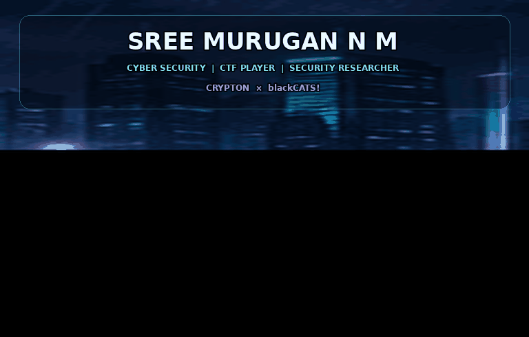

# 👾 CRYPTON.exe — Digital Identity

<p align="center">
  
</p>

<h1 align="center">⚡ SREE MURUGAN N M ⚡</h1>

<h3 align="center">Cyber Security Enthusiast | CTF Player | Security Researcher</h3>

<p align="center">
  
</p>

<p align="center">
  
  
  
</p>

---

<h2 align="center">01 · ABOUT ME</h2>

```bash
┌──(crypton㉿blackCATS!)-[~]
│
├── Name       : Sree Murugan N M
├── Alias      : CRYPTON
├── Education  : B.E. CSE (Cyber Security)
├── Institution: Sri Shakthi Institute of Engineering
├── Interests  : Cyber Security, CTF, Digital Forensics
├── Focus      : Web & Network Security
└── Mission    : Discover. Understand. Secure.
```

I'm a cybersecurity enthusiast passionate about exploring vulnerabilities, understanding systems and developing security-focused solutions.

I enjoy CTF competitions, ethical hacking, digital forensics, Linux and security research.

---

<h2 align="center">02 · CURRENT OPERATIONS</h2>

<p align="center">
  
</p>

- 🔐 Advanced Web Penetration Testing
- 💻 JavaScript and MongoDB
- 🌐 Computer Networking
- 🔎 Digital Forensics
- 🐧 Linux and Security Research

**Goal:** Become a professional Cyber Security Engineer and Security Researcher.

---

<h2 align="center">03 · THE CREW — blackCATS!</h2>

<p align="center">
  
</p>

<h3 align="center">ONE TEAM. ONE MISSION. UNLIMITED POSSIBILITIES.</h3>

<p align="center">
  <i>Think together. Exploit together. Win together.</i>
</p>

- 🏆 7th Overall Position at AXIOS'26 CTF.
- 🎯 Qualified for onsite Jeopardy among 50+ teams.
- ⚔️ Attack-Defense CTF experience.
- 🌐 blackCATS! listed on CTFtime.
- 🧠 Constantly solving challenges and learning together.

<p align="center">
  <a href="YOUR_BLACKCATS_CTFtime_URL">
    
  </a>
</p>

---

<h2 align="center">04 · TECHNICAL ARSENAL</h2>

<h3 align="center">⌨️ Programming & Development</h3>

<p align="center">
  
</p>

<h3 align="center">🐧 Operating Systems & Tools</h3>

<p align="center">
  
</p>

<h3 align="center">🔐 Security Toolkit</h3>

<p align="center">
  
  
  
  
  
  
  
  
  
</p>

---

<h2 align="center">05 · PROJECT SHOWCASE</h2>

<h3 align="center">🔍 OPERATION HATA</h3>

<p align="center">
  
</p>

Hidden Attachment Threat Analyzer — a cybersecurity solution designed to inspect suspicious attachments using multiple security analysis techniques.

<p align="center">
  <code>Python</code> <code>React</code> <code>FastAPI</code> <code>YARA</code>
</p>

<h3 align="center">🏁 CTF & HACKATHON TRACKER</h3>

A development project focused on organizing CTF competitions, hackathons and participation details.

<p align="center">
  <code>Development</code> <code>Tracking</code> <code>Productivity</code>
</p>

<h3 align="center">🌐 PERSONAL PORTFOLIO</h3>

A personal website showcasing development work, technical skills and achievements.

<p align="center">
  <code>HTML</code> <code>CSS</code> <code>JavaScript</code>
</p>

<h3 align="center">🧪 CYBERSECURITY LEARNING LABS</h3>

Hands-on experiments involving Linux, networking, programming and security challenges.

<p align="center">
  <code>Linux</code> <code>Python</code> <code>Networking</code>
</p>

---

<h2 align="center">06 · ACHIEVEMENTS & RECOGNITION</h2>

<p align="center">
  
</p>

<p align="center">
  
</p>

| Achievement | Recognition |
|:---|:---|
| 🏆 AXIOS'26 CTF | 7th Overall |
| 🎯 Jeopardy Round | Onsite Qualified |
| ⚔️ Attack-Defense | Competition Experience |
| 🏁 INCTF | Participant |
| 🏃 OWASP SREC Chapter | Runner |
| 🐈‍⬛ blackCATS! | CTFtime Listed |

---

<h2 align="center">07 · GITHUB ANALYTICS</h2>

<p align="center">
  
  
</p>

<h3 align="center">🔥 CONTRIBUTION STREAK</h3>

<p align="center">
  
</p>

<h3 align="center">📈 CONTRIBUTION ACTIVITY</h3>

<p align="center">
  
</p>

---

<h2 align="center">08 · CONNECT WITH CRYPTON</h2>

<p align="center">
  <a href="https://github.com/Crypton-ctrl">
    
  </a>
  <a href="YOUR_LINKEDIN_URL">
    
  </a>
  <a href="mailto:nmsreemurugan07@gmail.com">
    
  </a>
</p>

<p align="center">
  
</p>

---

<h2 align="center">09 · FINAL TRANSMISSION</h2>

<p align="center">
  
</p>

<h3 align="center">🔍 EXPLORE · ⚡ UNDERSTAND · 🔐 SECURE</h3>

<p align="center">
  <b>🐈‍⬛ blackCATS! × CRYPTON</b>
</p>

<p align="center">
  <i>Every vulnerability has a story. Every exploit teaches something.</i>
</p>

<p align="center">
  
</p>
